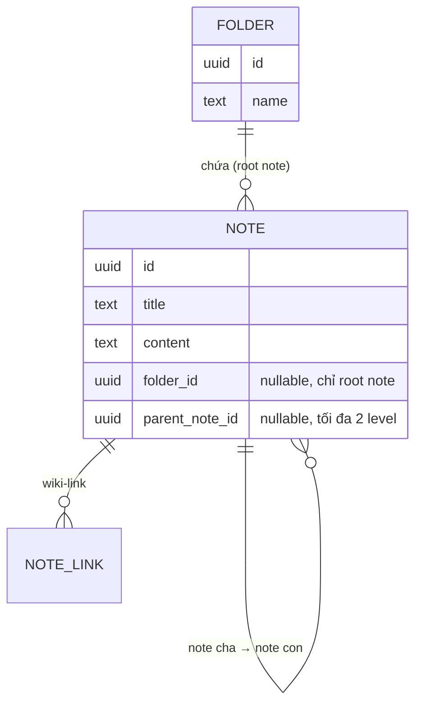

# Nodus — SPEC v2: Folder + Note phân cấp

> Thay thế [SPEC-v1.md](SPEC-v1.md). Giữ nguyên Stack, markdown thuần + `[[wiki-link]]`, cơ chế `note_links`. Chi tiết business rule đầy đủ nằm ở [docs/frd/](docs/frd/) — file này chỉ tóm tắt.
> Phần Editor/Wiki-link/Backlink còn thiếu (chưa implement) → xem [SPEC-v3.md](SPEC-v3.md).

## Vấn đề với v1

Note phẳng, không có cách tổ chức ngoài search/graph.

## Tính năng mới

- **Folder**: CRUD đầy đủ. Xem [[FRD-folder]].
- **Note phân cấp tối đa 2 level**: note gốc (có/không folder) → note con (kế thừa folder từ cha). Xem [[FRD-note-hierarchy]].
- **Move note** giữa folder/note cha: `PATCH /notes/:id/move`. Xem [[FRD-move-note]].
- **Nội dung**: chỉ markdown — bỏ rich-text (không convert lossless được).
- **Graph 1 note**: gộp cạnh cha–con + cạnh `[[wiki-link]]`.

## Sơ đồ quan hệ dữ liệu



## Schema

```sql
CREATE TABLE folders (
    id UUID PRIMARY KEY DEFAULT uuid_generate_v4(),
    name TEXT NOT NULL,
    created_at TIMESTAMPTZ NOT NULL DEFAULT now(),
    updated_at TIMESTAMPTZ NOT NULL DEFAULT now()
);

CREATE TABLE notes (
    id UUID PRIMARY KEY DEFAULT uuid_generate_v4(),
    title TEXT NOT NULL,
    content TEXT NOT NULL DEFAULT '',
    folder_id UUID REFERENCES folders(id) ON DELETE CASCADE,
    parent_note_id UUID REFERENCES notes(id) ON DELETE CASCADE,
    created_at TIMESTAMPTZ NOT NULL DEFAULT now(),
    updated_at TIMESTAMPTZ NOT NULL DEFAULT now()
);
```

Ràng buộc chỉ khả thi ở tầng service (không phải CHECK constraint): note con luôn `folder_id = NULL` (kế thừa từ cha khi hiển thị); note đã có cha thì không được làm cha của note khác (chặn quá 2 level).

## API (bổ sung/thay đổi so với v1)

| Method   | Path              | Việc                                          |
| -------- | ----------------- | --------------------------------------------- |
| POST/GET | `/folders`        | Tạo / list folder                             |
| GET      | `/folders/:id`    | Chi tiết + note gốc bên trong                 |
| PATCH    | `/folders/:id`    | Đổi tên                                       |
| DELETE   | `/folders/:id`    | Cascade note bên trong (client confirm trước) |
| POST     | `/notes`          | + `folderId?`, `parentNoteId?`                |
| PUT      | `/notes/:id`      | Chỉ `title`/`content`                         |
| PATCH    | `/notes/:id/move` | Đổi folder / note cha — xem [[FRD-move-note]] |

Endpoint khác giữ nguyên v1.

## Xóa — cascade

- Xóa folder còn note bên trong → cascade xóa hết (client cảnh báo trước).
- Xóa note cha → cascade xóa note con.

## UI — Sidebar

- `UTree` (Nuxt UI) thay list phẳng: Folder → note gốc → note con.
- Search + "+ New note" giữ nguyên vị trí như v1.
- Move note qua modal "Move to..." (nút 3 chấm trên mỗi item) — xem [[FRD-move-note]].
- Quan hệ cha–con chỉ thiết lập lúc **tạo note** (không có UI re-parent lúc tạo — chỉ move mới re-parent được, xem FRD).

## Chưa chốt

- Roadmap thứ tự implement (migration → API → UI) — chốt khi bắt đầu từng phần.

## Nợ kỹ thuật

- **Service layer domain `note`**: ✅ xong — business logic tách vào `note/service.go`, `Handler` chỉ còn parse request + gọi `Service` (interface, `note/interface.go`) + trả response.
- **Service layer domain `folder`**: ✅ xong — cùng pattern, `folder/service.go` + `folder/interface.go`. `FindDetailByID` (gọi chéo sang `note.Repository` cho `GET /folders/:id`) giờ nằm ở Service, không phải Handler.
- **Repository interface**: chưa có — `Service` ở cả 2 domain vẫn giữ `*Repository` (struct cụ thể), không phải interface. Chỉ cần làm khi có nhu cầu thật (viết unit test cho Service, cần mock DB) — cố tình chưa làm trước.

## Note gốc re-parent nếu chưa có con (chốt, đã implement)

Note gốc được phép re-parent (move thành con của note khác) **nếu chưa có con nào** — chỉ chặn khi việc re-parent sẽ tạo 3-level thật sự (note gốc đó đang có con).

- **Field `hasChildren: boolean`** đã thêm vào `Note` — có mặt ở mọi response (`GET /notes`, `GET /notes/:id`, sau `POST/PUT/PATCH .../move`, và bên trong `GET /folders/:id`).
- **Cách tính, tránh N+1**: `FindAll`/`FindByFolderID` (list) dùng 1 query phụ `FindParentNoteIDsWithChildren` lấy toàn bộ `parent_note_id` đang tồn tại, map ở tầng Go — không phụ thuộc số lượng note trả về. `FindByID`/`Update`/`Move` (single note) dùng `NoteHasChildren` riêng. `Create` không cần query — note mới luôn `hasChildren = false`.
- **Validate ở `service.Move`**: note đang move là note gốc + có `parentNoteId` → chặn nếu `note.HasChildren == true`, cho qua nếu `false`.
- **Còn thiếu ở FE**: modal "Move to..." cần đọc `hasChildren` để disable tùy chọn "chọn note cha khác" ngay khi mở — chưa làm (chưa có UI nào cho move).
