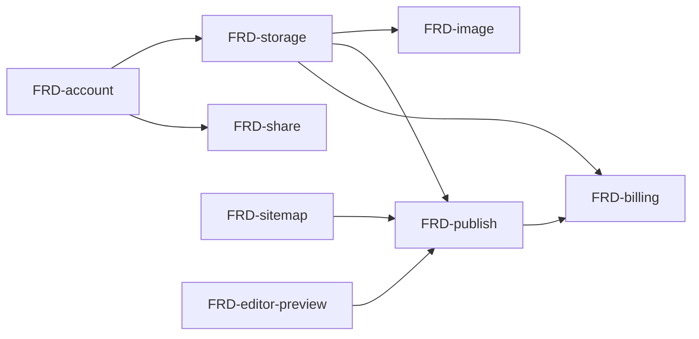

# Nodus — SPEC v5: Tài liệu kỹ thuật dạng liên kết

> Đổi hướng từ personal knowledge base ([[SPEC-v1]] → [[SPEC-v4]]) sang nơi viết tài liệu kỹ thuật. Lý do và mô hình kinh doanh xem [[BRD]]. File này chỉ tóm tắt; chi tiết nằm ở `docs/frd/`.

## Thay đổi so với v4

- **Bỏ graph**: tab Graph ở panel phải, `graph-panel.vue`, plugin `v-network-graph`. Minimap graph của v4 và global graph `/graph` của v1 không làm nữa. Xem [[FRD-remove-graph]].
- **Giữ**: editor CodeMirror, preview markdown-it, mermaid, `[[wiki-link]]`, tab Backlinks, folder + note cha/con, tab kiểu VSCode, MCP.
- **Thêm**: tô màu code theo ngôn ngữ, HTML/SVG có lọc, sitemap có thứ tự, tài khoản, lưu trữ Drive/Nodus, share, publish, chat AI bằng key riêng.

## Danh sách FRD

| # | FRD | Trạng thái | Ưu tiên | Cần duyệt |
| --- | --- | --- | --- | --- |
| 1 | [[FRD-folder]] | Có sẵn | — | — |
| 2 | [[FRD-note-hierarchy]] | Sửa cho khớp code (re-parent note gốc) | P1 | — |
| 3 | [[FRD-move-note]] | Sửa cho khớp code (re-parent note gốc) | P1 | — |
| 4 | [[FRD-wiki-link]] | Viết lại từ `features/note-links.md` | P1 | — |
| 5 | [[FRD-remove-graph]] | Mới | P1 | Xóa code, gỡ dependency |
| 6 | [[FRD-editor-preview]] | Mới | P1 | Dependency (DOMPurify, ngôn ngữ CodeMirror) |
| 7 | [[FRD-sitemap]] | Mới | P1 | Schema |
| 8 | [[FRD-account]] | Mới | P1 | Auth, schema |
| 9 | [[FRD-page-toc]] | Mới | P2 | — |
| 10 | [[FRD-image]] | Mới | P2 | Schema/lưu trữ |
| 11 | [[FRD-storage]] | Mới | P2 | Auth, schema, kiến trúc |
| 12 | [[FRD-share]] | Mới | P2 | Auth |
| 13 | [[FRD-publish]] | Mới | P2 | API, hạ tầng |
| 14 | [[FRD-billing]] | Mới | P3 | Thanh toán |
| 15 | [[FRD-ai-chat]] | Mới | P3 | Bảo mật key |
| 16 | [[FRD-mcp]] | Viết lại từ README | P3 | — |
| 17 | [[FRD-export]] | Mới | P3 | — |
| 18 | [[FRD-template]] | Mới | P3 | — |

- **P1**: làm gọn lõi theo hướng mới.
- **P2**: lưu trữ, chia sẻ, publish.
- **P3**: thu phí, AI, tiện ích.

## Thứ tự phụ thuộc

Publish hiển thị nội dung người dùng cho người lạ → [[FRD-editor-preview]] (lọc HTML/SVG) phải xong trước.

## Chưa chốt

- Lệch giữa [[SPEC-v3]] ("rebuild link trong cùng transaction") và code hiện tại (không có transaction) — xem [[FRD-wiki-link]].
