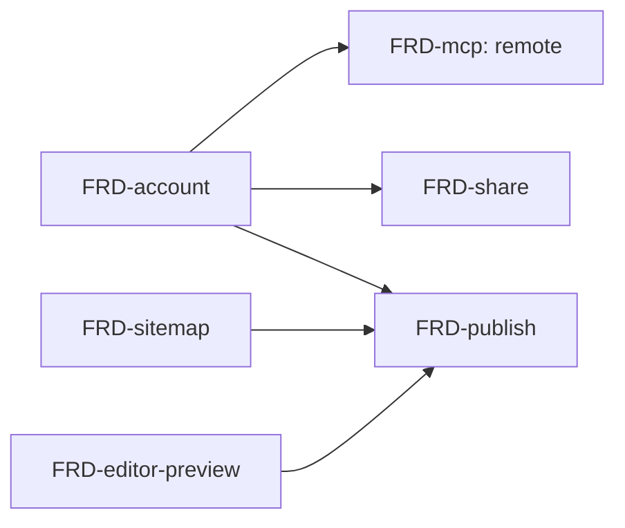

# Nodus — SPEC v5: Tài liệu kỹ thuật dạng liên kết

> Đổi hướng từ personal knowledge base ([[SPEC-v1]] → [[SPEC-v4]]) sang nơi viết tài liệu kỹ thuật. Lý do và mô hình kinh doanh xem [[BRD]]. File này chỉ tóm tắt; chi tiết nằm ở `docs/frd/`. Tech stack xem [[ADR-001-tech-stack]].

## Thay đổi so với v4

- **Bỏ graph**: không port sang `next-nodus`; minimap graph của v4 và global graph `/graph` của v1 không làm. Nhu cầu "xem chỗ liên quan" có tab Backlinks ([[FRD-wiki-link]]), "xem cấu trúc" có sitemap ([[FRD-sitemap]]). Graph biến mất khi gỡ `web-nodus`.
- **Giữ**: editor CodeMirror, mermaid, `[[wiki-link]]`, Backlinks, MCP.
- **Đổi cây**: từ folder → note → note con (2 cấp) sang **folder và doc lồng nhiều cấp** (tối đa 4), folder là chỗ chứa có `description`, doc là nội dung. "Note" đổi tên thành **doc**.
- **Đổi stack**: frontend viết mới (`next-nodus`), preview chuyển từ markdown-it sang unified + Shiki, backend Fiber → Gin — xem [[ADR-001-tech-stack]].
- **Thêm**: tô màu code theo ngôn ngữ, HTML/SVG có lọc, mục lục, chế độ Viết/Đọc, tab nhiều tài liệu, sitemap có thứ tự, lưu tự động có xử lý xung đột, tìm kiếm, tài khoản, share, publish, export; xa hơn: lưu trữ Drive, billing, chat AI, ảnh, mẫu.

## Giai đoạn đầu

Billing, chat AI, ảnh, mẫu tài liệu để sau. **Mọi dữ liệu lưu trên Nodus (Postgres)**; chủ sở hữu dữ liệu là workspace (một user thuộc nhiều workspace, một workspace có nhiều user; mỗi account tự có một workspace cá nhân); publish miễn phí trên tên miền riêng. Google Drive (làm trước khi release, sau MCP) chỉ là nơi **import/export file markdown** — sao chép vào/ra DB, không đồng bộ hai chiều, theo kiểu draw.io. Khác với [[BRD]] mục 6 (miễn phí = lưu trên Drive) và [[FRD-storage]] — cần cập nhật khi làm Drive.

## Danh sách FRD

| # | FRD | Trạng thái | Ưu tiên | Cần duyệt |
| --- | --- | --- | --- | --- |
| 1 | [[FRD-folder]] | Backend có sẵn, đổi theo cây mới | P1 | Schema, API |
| 2 | [[FRD-doc]] | Backend có sẵn (tên note), đổi theo cây mới | P1 | Schema, API |
| 3 | [[FRD-move]] | Backend có sẵn, đổi theo cây mới | P1 | API contract |
| 4 | [[FRD-sitemap]] | Mới (cấu trúc cây, thứ tự, trang trước/sau) | P1 | Schema, API |
| 5 | [[FRD-wiki-link]] | Có sẵn (backend); thêm link tới heading | P1 | API |
| 6 | [[FRD-editor-preview]] | Mới (gồm mục lục, anchor) | P1 | Dependency |
| 7 | [[FRD-autosave]] | Mới | P1 | Schema (`version`), API |
| 8 | [[FRD-search]] | Mới | P1 | API |
| 9 | [[FRD-account]] | Mới; đăng nhập email/password làm trước | P1 | Auth, schema |
| 10 | [[FRD-tabs]] | Mới (từ [[SPEC-v4]], chưa từng làm) | P1 | — |
| 11 | [[FRD-mcp]] | Có sẵn (stdio); chuyển sang MCP Go SDK, thêm PAT, remote MCP | P1 | Auth |
| 12 | [[FRD-share]] | Mới | P2 | Auth |
| 13 | [[FRD-publish]] | Mới; miễn phí, chưa kiểm tra gói | P2 | API |
| 14 | [[FRD-export]] | Mới | P2 | API |
| 15 | [[FRD-image]] | Mới | Xa | Schema/lưu trữ |
| 16 | [[FRD-storage]] | Mới (Google Drive) | Xa | ADR riêng |
| 17 | [[FRD-billing]] | Mới | Xa | Thanh toán |
| 18 | [[FRD-ai-chat]] | Mới | Xa | Bảo mật key |
| 19 | [[FRD-template]] | Mới | Xa | — |

- **P1**: lõi theo hướng mới. **P2**: chia sẻ, publish, export. **Xa**: làm sau khi có người dùng thật.

Trước P1: giai đoạn 0 (nền backend — đã xong) và 1 (khung `next-nodus` — đang làm) theo [[ADR-001-tech-stack]] mục 7.

## Thứ tự phụ thuộc

Publish hiển thị nội dung người dùng cho người lạ → bộ lọc HTML/SVG của [[FRD-editor-preview]] phải xong trước.

## Chưa chốt

- Các mục còn mở ở [[ADR-001-tech-stack]] mục 8.
