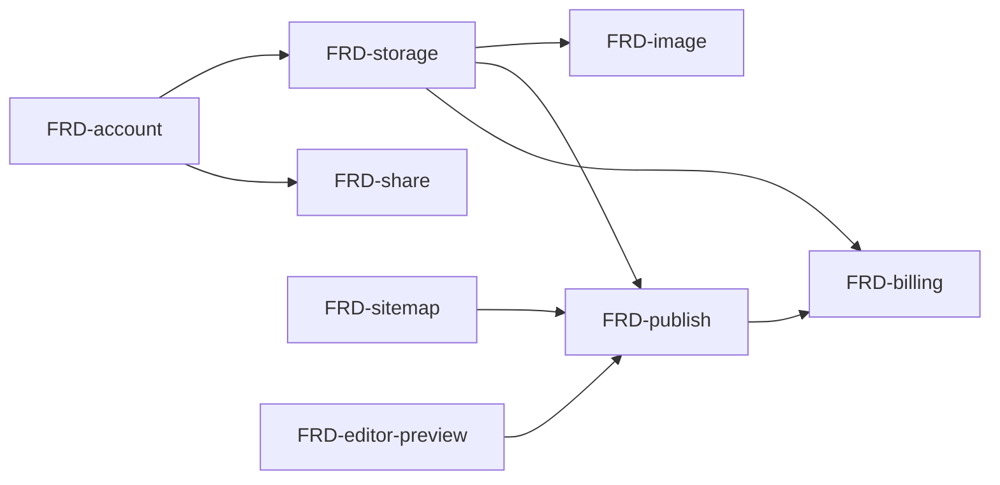

# Nodus — SPEC v5: Tài liệu kỹ thuật dạng liên kết

> Đổi hướng từ personal knowledge base ([[SPEC-v1]] → [[SPEC-v4]]) sang nơi viết tài liệu kỹ thuật. Lý do và mô hình kinh doanh xem [[BRD]]. File này chỉ tóm tắt; chi tiết nằm ở `docs/frd/`. Tech stack xem [[ADR-001-tech-stack]].

## Thay đổi so với v4

- **Bỏ graph**: không port sang `next-nodus`; minimap graph của v4 và global graph `/graph` của v1 không làm. Xem [[FRD-remove-graph]].
- **Giữ**: editor CodeMirror, mermaid, `[[wiki-link]]`, Backlinks, folder + note cha/con, MCP.
- **Đổi**: frontend viết mới (`next-nodus`), preview chuyển từ markdown-it sang unified + Shiki, backend chuyển Fiber → Gin — xem [[ADR-001-tech-stack]].
- **Thêm**: tô màu code theo ngôn ngữ, HTML/SVG có lọc, chế độ Viết/Đọc, tab nhiều tài liệu, sitemap có thứ tự, tài khoản, lưu trữ Drive/Nodus, share, publish, chat AI bằng key riêng.

## Danh sách FRD

| # | FRD | Trạng thái | Ưu tiên | Cần duyệt |
| --- | --- | --- | --- | --- |
| 1 | [[FRD-folder]] | Có sẵn (backend); UI port sang `next-nodus` | P1 | — |
| 2 | [[FRD-note-hierarchy]] | Có sẵn (backend); UI port sang `next-nodus` | P1 | — |
| 3 | [[FRD-move-note]] | Có sẵn (backend); UI port sang `next-nodus` | P1 | API contract (xem FRD) |
| 4 | [[FRD-wiki-link]] | Có sẵn (backend); UI port sang `next-nodus` | P1 | — |
| 5 | [[FRD-remove-graph]] | Xong khi gỡ `web-nodus` | P1 | — |
| 6 | [[FRD-editor-preview]] | Mới | P1 | Dependency (unified, rehype-sanitize, Shiki, ngôn ngữ CodeMirror) |
| 7 | [[FRD-sitemap]] | Mới | P1 | Schema |
| 8 | [[FRD-account]] | Mới | P1 | Auth, schema |
| 9 | [[FRD-tabs]] | Mới (từ [[SPEC-v4]], chưa từng làm) | P1 | — |
| 10 | [[FRD-page-toc]] | Mới | P2 | — |
| 11 | [[FRD-image]] | Mới | P2 | Schema/lưu trữ |
| 12 | [[FRD-storage]] | Mới | P2 | Auth, schema, kiến trúc |
| 13 | [[FRD-share]] | Mới | P2 | Auth |
| 14 | [[FRD-publish]] | Mới | P2 | API, hạ tầng |
| 15 | [[FRD-billing]] | Mới | P3 | Thanh toán |
| 16 | [[FRD-ai-chat]] | Mới | P3 | Bảo mật key |
| 17 | [[FRD-mcp]] | Có sẵn (stdio); chuyển sang MCP Go SDK, thêm PAT | P3 | Auth |
| 18 | [[FRD-export]] | Mới | P3 | — |
| 19 | [[FRD-template]] | Mới | P3 | — |

- **P1**: làm gọn lõi theo hướng mới.
- **P2**: lưu trữ, chia sẻ, publish.
- **P3**: thu phí, AI, tiện ích.

Trước P1: giai đoạn 0 (nền backend — đã xong: Gin + GORM + Atlas, rebuild link chung transaction với update content) và 1 (khung `next-nodus` — đang làm) theo kế hoạch ở [[ADR-001-tech-stack]] mục 7. Mọi FRD từ P1 trở đi làm trên stack mới.

## Thứ tự phụ thuộc

Publish hiển thị nội dung người dùng cho người lạ → [[FRD-editor-preview]] (lọc HTML/SVG) phải xong trước.

## Chưa chốt

- Các mục còn mở ở [[ADR-001-tech-stack]] mục 8.
