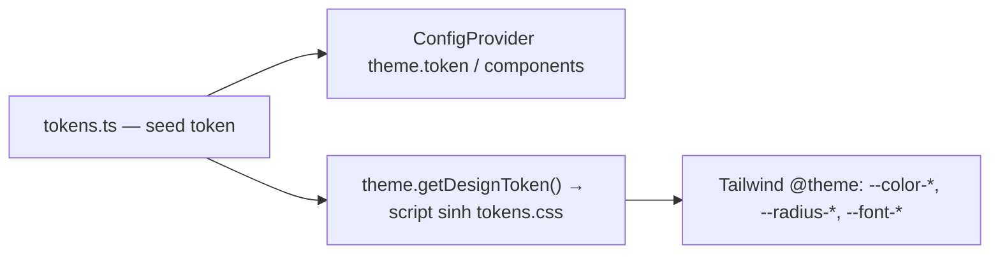

# ADR-001 — Tech stack cho hướng tài liệu kỹ thuật

> Trạng thái: **Đã chốt** — 2026-11-05. Bối cảnh sản phẩm xem [[BRD]], phạm vi tính năng xem [[SPEC-v5]].

## 1. Bối cảnh

[[BRD]] (2026-11-04) đổi Nodus từ ghi chú cá nhân sang **nơi viết tài liệu kỹ thuật dạng liên kết**, có tài khoản, lưu trữ Drive/Nodus, share, publish, MCP và chat AI. Review code hiện tại (2026-11-05) cho thấy:

| Vùng | Hiện trạng |
| --- | --- |
| Frontend (`web-nodus`, Nuxt) | Autosave mất dữ liệu khi đang lưu hoặc chuyển trang; sidebar/breadcrumb không cập nhật sau rename/xóa; không dùng được trên mobile; preview không đọc được (heading cùng cỡ, mất số thứ tự list, bảng không viền, tương phản light theme 1.7:1); vibe nặng IDE |
| Backend (`go-nodus`) | Fiber chạy trên fasthttp, không tương thích `net/http` (MCP SDK, OAuth, SSE, tách service); validate viết tay; trả nguyên lỗi DB ra client; migration chạy tay bằng `psql -f`; không có test |
| Chung | Chưa có auth; dependency import nhưng chưa khai báo; quy tắc agent mô tả quy trình Prisma không khớp repo (đã chuyển sang `CLAUDE.md`) |

Mục tiêu khi chọn stack: **tốc độ phát triển**, **UI/UX tốt cho người viết và người đọc**, giữ Go cho backend để mở đường tách service và tích hợp AI.

## 2. Quyết định

| Lớp | Chọn | Ghi chú |
| --- | --- | --- |
| Backend | **Go + Gin** | Chuẩn `net/http` — dùng chung được MCP Go SDK, `x/oauth2`, SSE |
| Kiến trúc backend | **Mỗi domain một package** (`internal/modules/folder`, `internal/modules/doc`, `internal/modules/link`, `internal/modules/tree`) gồm **handler + service**; `internal/httpx` chỉ giữ phần HTTP dùng chung (router, response, lỗi, middleware); **`cmd/api`** là composition root, DI bằng constructor viết tay. `tree` có thêm `Repository` (truy vấn tách khỏi quy tắc cây); module khác gọi GORM trong service | Handler chỉ bind → gọi service → response. Service kiểm tra quy tắc → GORM, nhận `ctx`, tự mở transaction. `cmd/api/main.go` đọc config và chạy; `app.go` mở DB, dựng module, chạy server và tắt êm (graceful shutdown); `modules.go` ghép dependency |
| Tài liệu API | **swaggo** | Annotation trên handler; `make swagger` sinh `internal/apidocs/`; UI ở `/swagger/index.html` |
| Truy cập DB | **GORM** (driver Postgres/pgx) | Struct trong `internal/db/models.go` là nguồn schema duy nhất |
| Migration | **Atlas** | `atlas migrate diff` sinh SQL từ model GORM (`atlas-provider-gorm`), người review, `atlas migrate apply`; DB tạm cho diff/rollback là Postgres trên RAM (service `atlas-dev-db`, tạo và xóa theo từng lệnh). Rollback: `atlas migrate down` tự tính SQL đảo ngược và chặn nếu làm mất dữ liệu; migration đã chia sẻ thì roll forward bằng migration mới. Giống `migration:generate` của TypeORM |
| Công cụ | `go tool air`, `go tool atlas-provider-gorm` (ghim trong `go.mod`); Atlas chạy bằng Docker (`arigaio/atlas:1.3.6` bản chính thức — miễn phí, không cần đăng nhập, có `migrate down` mà bản community thiếu; service `atlas-migrate-runner`, chỉ chạy khi gọi `make migrate-*`) | Không ai phải cài Atlas; thành viên mới chỉ cần Go, Docker, `make` |
| Auth | **Session (cookie) + PAT**, OAuth Google/GitHub/GitLab | JWT chỉ dùng **nội bộ giữa service** khi tách service — chi tiết [[FRD-account]] |
| Frontend | **Next.js (React)** — folder mới `next-nodus/` | Chạy chủ yếu client component; mọi dữ liệu đi qua API Go, không dùng Server Actions/route handler cho nghiệp vụ |
| UI | **Ant Design v6 + Tailwind CSS v4** | antd cho component, Tailwind cho layout/tinh chỉnh — mục 4 |
| Gọi dữ liệu | **TanStack Query** + hàm gọi API trong `api/` dựa trên `httpClient`, hook viết tay, type viết tay đối chiếu Swagger | Cache/invalidate thống nhất |
| State UI phía client | **zustand** (`shared/stores`) | Chia sẻ state giữa component (độ rộng sidebar, tab); dữ liệu server vẫn ở TanStack Query |
| Kiểm tra dữ liệu nhập | **zod** | Schema khai báo một lần cho ô nhập (ví dụ tên node); server vẫn là bên quyết định, client chỉ báo lỗi sớm |
| Icon | **lucide-react** (chốt 2026-11-10, thay `@heroicons/react`) | Một bộ icon dùng chung cho cả app; có sẵn icon cho panel (thu gọn/mở), thư mục, file |
| Editor | **CodeMirror 6** (giữ) | Lưu markdown thuần |
| Render markdown | **unified** (remark-gfm, rehype-sanitize) + **Shiki** + `@tailwindcss/typography` | Một pipeline cho preview và publish; lọc HTML/SVG sẵn |
| Repo | Một repo: `go-nodus/`, `next-nodus/` (`web-nodus/` giữ tới khi thay xong) | Hợp đồng FE↔BE đối chiếu qua Swagger |

## 3. Phương án đã loại

| Phương án | Lý do loại |
| --- | --- |
| Bỏ Go, full-stack TypeScript (Next + Prisma) | Muốn giữ Go cho tách service, AI |
| Fiber (giữ) | Không tương thích `net/http` |
| Huma | Chọn swaggo — quen thuộc, ít ràng buộc cách viết handler |
| sqlc + golang-migrate (chọn rồi đổi, 2026-11-05) | Viết SQL cho từng query rồi generate; chậm hơn khi P1–P2 đổi schema nhiều lần |
| GORM + SQL migration tự viết | Viết schema 2 lần (SQL + struct), dễ lệch |
| handler → service → repository cho mọi module | Quá nhiều lớp cho quy mô hiện tại, khó nắm; chỉ `tree` dùng repository vì quy tắc của nó cần tách khỏi truy vấn |
| DI framework (uber-go/fx, google/wire) | Thêm dependency (fx resolve lúc chạy bằng reflection, wire cần bước sinh code); wiring hiện chỉ vài dòng trong `cmd/api/modules.go`, constructor viết tay đủ rõ |
| ent | Học nhiều, viết lại tầng dữ liệu; lợi ích (privacy, soft delete tự động) chưa đủ bù |
| JWT cho trình duyệt | Thu hồi phức tạp (refresh rotation, `token_version`); token trong JS dễ lộ qua XSS khi Nodus hiển thị HTML/SVG người dùng viết |
| Nuxt + Nuxt UI (giữ) | Chọn hệ sinh thái React + antd |
| shadcn/ui, daisyUI, HeroUI, Mantine | Không thích kiểu headless/copy-paste; thiếu Tree, Splitter; Mantine không dựa trên Tailwind |

## 4. antd v6 + Tailwind v4

**Triết lý:** tận dụng component của antd, linh hoạt của Tailwind. Tailwind thắng khi xung đột; `!important` chỉ dùng cho số ít chỗ không ghi đè được.

### Thứ tự layer

```css
/* next-nodus: app/globals.css */
@layer theme, base, antd, components, utilities;
@import "tailwindcss";
```

- `antd` nằm **trên `base`**: preflight của Tailwind không phá style antd (nút, input…).
- `antd` nằm **dưới `utilities`**: class Tailwind luôn thắng style antd, không phụ thuộc specificity.
- antd được đưa vào `@layer antd` qua `StyleProvider layer` (Next App Router: `AntdRegistry` của `@ant-design/nextjs-registry`).
- Phần bên trong component dùng **semantic `classNames`/`styles`** của antd v6, ví dụ `<Modal classNames={{ body: "p-6" }} />`.

### Bộ token chung

Một nguồn duy nhất `next-nodus/shared/theme/tokens.ts` (seed token cho light và dark, hàm `buildThemeConfig`):



- antd nhận seed qua `ConfigProvider`, tự tính màu phái sinh (hover, active, nền…) bằng algorithm light/dark.
- `pnpm tokens` (`shared/theme/buildTokens.mts`) gọi `theme.getDesignToken()` với cùng cấu hình để sinh `shared/theme/tokens.css` (biến `--nodus-*` cho light và dark) → Tailwind `@theme` dùng lại, nên `bg-primary`, `text-fg-muted`, `rounded-md` khớp đúng antd, kể cả màu phái sinh. File sinh ra được commit; sửa `tokens.ts` thì chạy lại `pnpm tokens`.
- Dark mode: một nguồn trạng thái điều khiển cả algorithm antd lẫn `@custom-variant dark` của Tailwind (`data-theme` trên `<html>`) — component portal (Modal, Dropdown) cũng nhận đúng theme.
- Seed cho antd viết bằng **hex** (antd không tính màu phái sinh từ `oklch`).

### Chỗ dự kiến phải dùng `!important`

Style inline do antd tự đặt (style attribute luôn thắng mọi layer): kích thước panel của `Splitter`, vị trí popup, một số animation. Mỗi chỗ dùng `!important` ghi chú lý do ngay tại code.

## 5. Định hướng giao diện

| | Người viết (workspace) | Người đọc (preview, publish) |
| --- | --- | --- |
| Cảm giác | Viết tài liệu, gọn, không nặng IDE | Tài liệu chuyên nghiệp, dễ đọc |
| Editor / nội dung | Font sans cho văn bản, mono chỉ trong code block; heading hiện đúng cấp; ký hiệu markdown dịu; hiện số dòng; cột viết ~80 ký tự, căn giữa; title là H1 lớn | Body 16px, line-height ~1.7, dòng ≤ ~72 ký tự; heading có thứ bậc; chữ trung tính, link màu thương hiệu, chữ đậm không đổi màu; bảng có viền; code có nhãn ngôn ngữ + nút copy |
| Bố cục | Editor bên trái, panel phải (tab Preview, Links) kéo đổi độ rộng; chỉ preview thu gọn được (có hiệu ứng) và có nút xem toàn màn hình | — |
| Theme | Light/Dark cho app; theme màu code chọn riêng | Theme đọc cố định, đạt WCAG AA |

Chỉ có 2 theme: **light** và **dark** (theo `data-theme` trên `<html>`, mặc định theo hệ điều hành). Bảng màu chốt: **Slate & Blue** (chọn qua demo `next-nodus`, thay bảng màu daisyUI cũ).

| Token | Light | Dark |
| --- | --- | --- |
| Màu thương hiệu (`primary`) | `#2563eb` | `#629bf8` (pha 20% trắng để sáng trên nền xám) |
| Nền app / nội dung / popup | `#f1f5f9` / `#ffffff` / `#ffffff` | `#212226` / `#27282d` / `#303136` (xám trung tính) |
| Viền / viền nhạt | `#d9e0e8` / `#e9eef4` | `#46474e` / `#37383e` |
| Chữ gốc | `#0f172a` | `#ececee` |
| Chữ trên nền màu nhấn đặc (`on-primary`) | trắng | `#111216` (tương phản ≈ 6.7:1) |

- Dark mode không dùng màu nhấn do thuật toán dark của antd sinh ra (bị xỉn): giữ sắc độ như light; nền nhạt của màu nhấn là lớp trong suốt 16–24% thay vì khối màu đặc.
- Link dùng màu thương hiệu (dark: sắc sáng hơn để dễ đọc).

Thang chữ và khoảng cách (token trong `shared/theme/tokens.ts`, class Tailwind `text-ui`, `text-ui-sm`, `text-doc`, `text-h1`–`text-h3`; bảng màu và thang chữ mặc định của Tailwind bị tắt trong `app/globals.css`, nên chỉ class theo token mới có tác dụng):

| | Giá trị |
| --- | --- |
| Giao diện (sidebar, nút, tab) | 14px; control cao 34px (nhỏ 26, lớn 40); dòng trên cây 30px; bo góc 8px |
| Chú thích, nhãn nhỏ (`text-ui-sm`) | 12px, line-height 1.5 |
| Nội dung tài liệu | 16px, line-height 1.75; H1/H2/H3 = 32/24/20px (nhỏ hơn mặc định 38/30/24 của antd); cột đọc ≤ 72 ký tự |

## 6. Hệ quả

- `next-nodus` viết mới; **không sửa bug frontend trên `web-nodus`** (trừ khi vẫn dùng hằng ngày — khi đó chỉ sửa lỗi mất dữ liệu autosave).
- Bài học từ bug cũ thành **tiêu chí chấp nhận** cho bản mới:
  - Autosave có hàng đợi, không ghi đè nội dung đang gõ, lưu khi rời trang/đóng tab.
  - Cột `version` trên tài liệu; lưu sai version → 409, FE báo xung đột (chặn ghi đè giữa UI và MCP).
  - Mọi thay đổi dữ liệu invalidate cache liên quan (sidebar, breadcrumb, cây).
  - Validate title (trim, 1–200 ký tự); escape ký tự đặc biệt khi search `ILIKE`.
  - Lỗi 500 không trả chi tiết DB; lỗi nghiệp vụ có `code` ổn định.
  - Layout dùng được trên mobile (tối thiểu chế độ đọc).
- Rủi ro của GORM — kém an toàn kiểu hơn sqlc, có bẫy (`Updates` bỏ qua giá trị rỗng, `Raw` không lọc soft delete, quên lọc `user_id`): ghi trong `CLAUDE.md`, lọc `user_id` qua một scope chung, test phân quyền; cân nhắc Row Level Security của Postgres sau.
- Rủi ro của Atlas — một số tính năng nâng cao gắn với Atlas Cloud; phần dùng (`migrate diff/apply/status/hash`) là bản miễn phí.
- Annotation swaggo có thể lệch code → CI (`go-nodus.yml`) chạy `make swagger` rồi `git diff --exit-code -- internal/apidocs`. CI chạy theo từng thư mục (`go-nodus`, `next-nodus`) và có thêm bước kiểm tra migration khi đổi schema (`go-nodus-migrate.yml`).
- `SPEC-v5` và các FRD đang nhắc file của `web-nodus`/Fiber → cập nhật dần khi làm từng FRD.

## 7. Kế hoạch chuyển đổi

| Giai đoạn | Việc |
| --- | --- |
| 0 — Nền | Model GORM khớp schema hiện tại + migration baseline của Atlas; Fiber → Gin với kiến trúc module (handler + service); `Makefile`; giữ hợp đồng API trừ thay đổi đã duyệt |
| 1 — Khung `next-nodus` | Next.js + antd v6 + Tailwind v4 (layer, token); TanStack Query; layout (Layout + Splitter), cây (Tree), editor CodeMirror, preview unified/Shiki; autosave theo tiêu chí mục 6 |
| 2 — P1 trên stack mới | [[FRD-editor-preview]], [[FRD-sitemap]], [[FRD-account]]; graph không port sang `next-nodus` (xem [[SPEC-v5]]) |
| 3 — Gỡ `web-nodus` | Khi `next-nodus` đủ tính năng — cần duyệt xóa |

## 8. Chưa chốt

- Hợp đồng `PATCH /notes/:id/move`: giữ `folderId`/`parentNoteId` (bắt buộc có key, cho phép null) hay đổi sang `targetType`/`targetId` (Swagger 2.0 không mô tả được nullable).
- Mô hình lưu trữ khi dùng Google Drive (nguồn gốc dữ liệu là Drive hay Postgres) — [[FRD-storage]].
- Trang publish render ở SPA hay ở Go (HTML tĩnh, SEO) — [[FRD-publish]].
- Command palette (antd không có sẵn).
- Thuật ngữ trên giao diện: "note" hay "doc"/"page".
