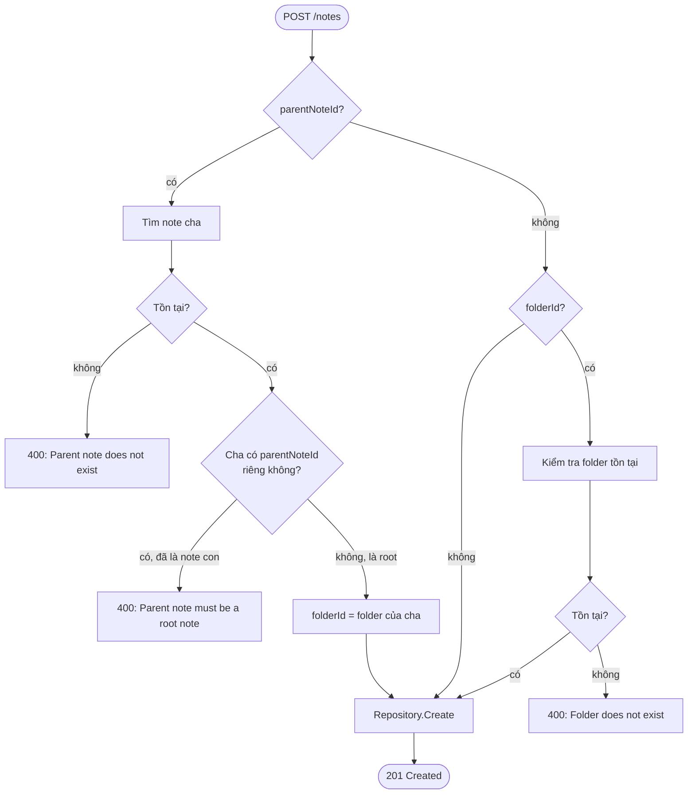
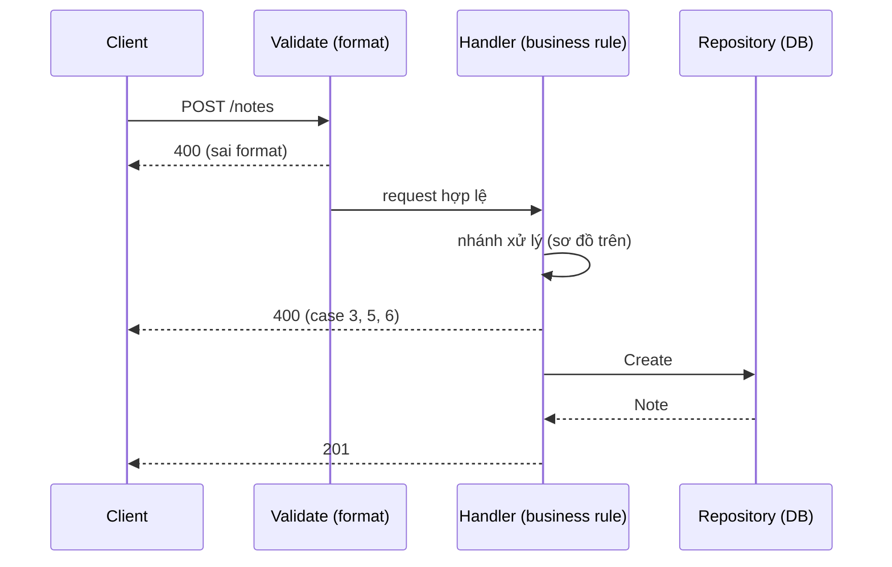

# Tạo note — `POST /notes`

Nguồn: [[FRD-note-hierarchy]], [[FRD-folder]]. Code: `go-nodus/internal/note/` (`routes.go`, `middleware.go`, `handler.go`, `repository.go`).

## Use case (tương ứng nhánh trong sơ đồ)

| # | Input | Kết quả | Nhánh |
|---|---|---|---|
| 1 | Không `folderId`, không `parentNoteId` | Note gốc, root | `HasParent=không` → `HasFolder=không` → **Create** |
| 2 | Có `folderId` hợp lệ, không `parentNoteId` | Note gốc, thuộc folder | `HasParent=không` → `HasFolder=có` → **FolderExists=có** → **Create** |
| 3 | `folderId` không tồn tại, không `parentNoteId` | `400` | ...→ **FolderExists=không** → **Err3** |
| 4 | `parentNoteId` hợp lệ (note cha là root) | Note con, `folderId` kế thừa từ cha | `HasParent=có` → **ParentExists=có** → **ParentIsRoot=không** → **Inherit** → **Create** |
| 5 | `parentNoteId` không tồn tại | `400` | `HasParent=có` → **ParentExists=không** → **Err1** |
| 6 | `parentNoteId` trỏ vào 1 note đã là con (3-level) | `400` | `HasParent=có` → **ParentExists=có** → **ParentIsRoot=có** → **Err2** |

Rule cốt lõi: `parentNoteId` **luôn thắng** `folderId` — khi có cha, `folderId` client gửi bị bỏ qua và server tự set theo folder của cha (rule kế thừa, [[FRD-note-hierarchy]]).

## Sơ đồ nhánh xử lý

## Flow code

## Rủi ro kỹ thuật

`note` domain không import package `folder` (tránh import cycle, vì `folder` đã import `note` cho `GET /folders/:id`). Nên việc check `folderId` tồn tại gọi thẳng `h.repo.queries.FindFolderByID` (tầng `db.Queries` sqlc dùng chung), không qua `folder.Repository`. Trade-off: `note` biết tên bảng `folders` ở mức SQL, chấp nhận được cho quy mô hiện tại; cần đổi sang gọi network nếu sau này tách `note`/`folder` thành service riêng.
