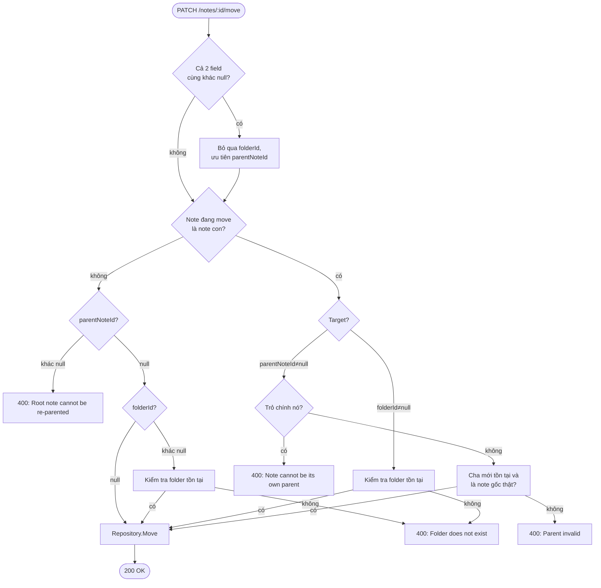
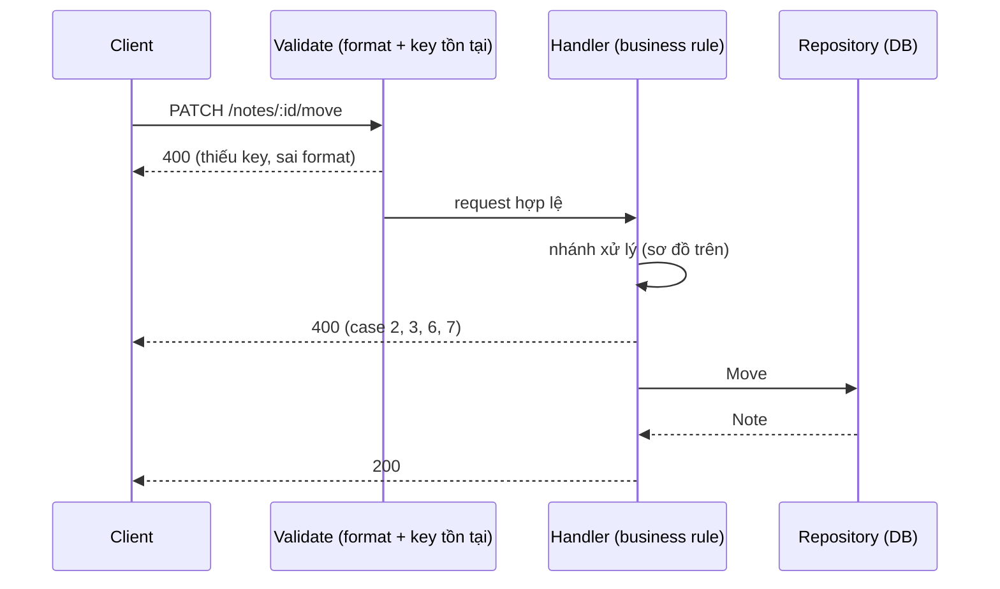

# Move note — `PATCH /notes/:id/move`

Nguồn: [[FRD-move-note]], [[FRD-note-hierarchy]]. Code: `go-nodus/internal/note/` (`routes.go`, `middleware.go`, `handler.go`, `repository.go`).

## Use case (tương ứng nhánh trong sơ đồ)

| # | Note đang move | Input | Kết quả | Nhánh |
|---|---|---|---|---|
| 1 | Note gốc | `folderId` hợp lệ, `parentNoteId: null` | Đổi folder, note con (nếu có) tự kế thừa | `isChild=không` → `folderId≠null` → **FolderExists=có** → **Move** |
| 2 | Note gốc | `folderId` không tồn tại | `400` | `isChild=không` → `folderId≠null` → **FolderExists=không** → **Err** |
| 3 | Note gốc | `parentNoteId≠null` (bất kể có con hay không) | `400` | `isChild=không` → `parentNoteId≠null` → **Err: root không re-parent** |
| 4 | Note con | `folderId` hợp lệ, `parentNoteId: null` | Tách khỏi cha, thành note gốc ở folder đó | `isChild=có` → `folderId≠null` → **FolderExists=có** → **Move** |
| 5 | Note con | `parentNoteId` hợp lệ (note gốc thật), `folderId: null` | Tách khỏi cha cũ, nối vào cha mới | `isChild=có` → `parentNoteId≠null` → **ParentValid=có** → **Move** |
| 6 | Note con | `parentNoteId` trỏ vào 1 note đã có cha (3-level) | `400` | ...→ **ParentValid=không (không phải root)** → **Err** |
| 7 | Note con | `parentNoteId` trỏ chính nó | `400` | ...→ **ParentValid=không (chính nó)** → **Err** |
| 8 | Bất kỳ | Thiếu hẳn 1 key trong body | `400` (chặn ở middleware) | Không tới handler |

Rule cốt lõi:
- **Note gốc** chỉ move được sang **folder** — không bao giờ re-parent, dù đang có con hay không.
- **Note con** move được theo **1 trong 2**: sang folder (tách khỏi cha) hoặc sang note cha khác (tách + nối lại). Không có case nào cả 2 field cùng có giá trị thật — nếu trái hợp đồng, server ưu tiên `parentNoteId`.

## Sơ đồ nhánh xử lý

## Flow code

## Rủi ro kỹ thuật

- **Thiếu key vs gửi `null`**: Go bind JSON không phân biệt được "field vắng mặt" với "field = null" (cả 2 ra `nil` con trỏ). Contract yêu cầu client **luôn gửi đủ 2 key**, nên middleware phải tự parse `map[string]json.RawMessage` trước để kiểm tra key có mặt hay không, trước khi bind vào struct thật.
- **Cả 2 field cùng khác null** (trái hợp đồng UI): server không từ chối — ưu tiên `parentNoteId`, bỏ qua `folderId`, nhất quán với rule đã dùng ở [[create-note|tạo note]].
