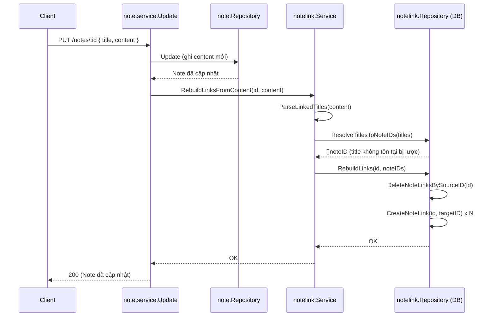
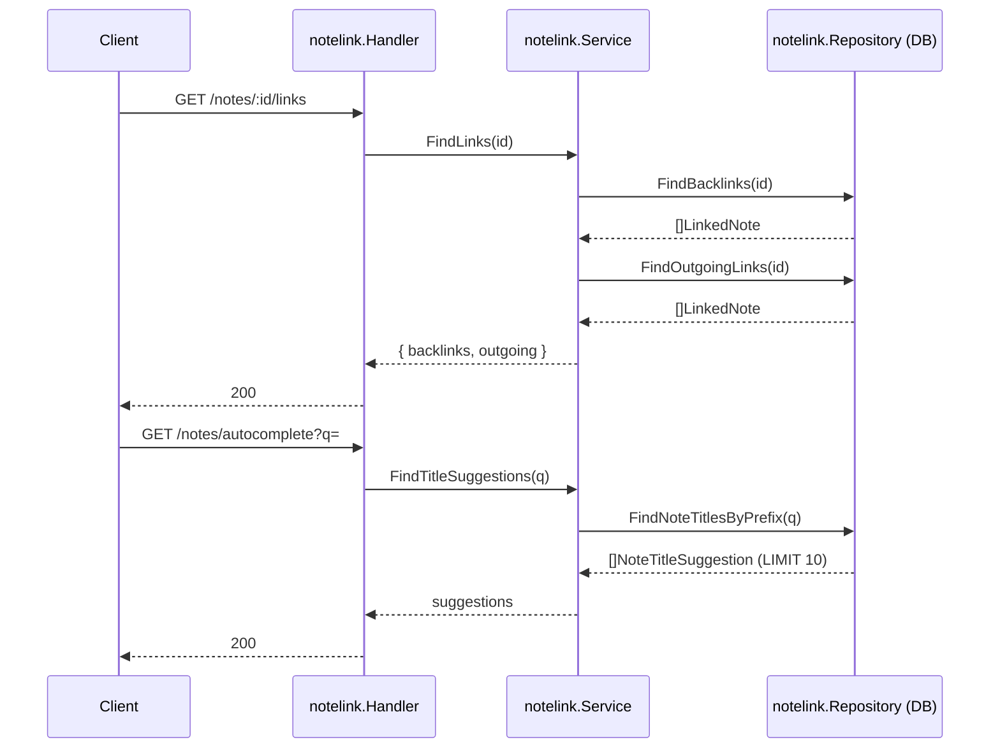

# Wiki-link & backlink — `PUT /notes/:id`, `GET /notes/:id/links`, `GET /notes/autocomplete`

Nguồn: [[SPEC-v3]]. Code: `go-nodus/internal/notelink/` (`parser.go`, `repository.go`, `service.go`, `handler.go`, `routes.go`), `go-nodus/internal/note/service.go` (điểm gọi vào).

## Flow 1 — Rebuild link khi save note

`PUT /notes/:id` sau khi update `content` thành công, tự động parse `[[Title]]` và ghi lại toàn bộ quan hệ `note_links` cho note đó.

### Use case

| # | Content | Kết quả `note_links` |
|---|---|---|
| 1 | Không có `[[...]]` nào | Xóa hết link cũ, không insert gì |
| 2 | `[[Note B]]`, note B tồn tại | 1 link `source=note hiện tại → target=Note B` |
| 3 | `[[Note X]]`, note X không tồn tại | Bỏ qua — không tạo note X, không insert link |
| 4 | `[[Note B]]` xuất hiện 2 lần | 1 link duy nhất (dedupe title trước khi resolve) |
| 5 | Trước đó có link tới Note C, sau khi sửa content bỏ `[[Note C]]` | Link cũ tới Note C bị xóa |

Rule cốt lõi: `note_links` **luôn được derive lại toàn bộ từ `content` hiện tại** — không có API insert/xóa link thủ công. Xóa cũ rồi insert mới mỗi lần save (không diff), nên không cần lo thứ tự add/remove.

### Sơ đồ nhánh xử lý

```mermaid
flowchart TD
    Start([Update content thành công]) --> Parse[Parse content:<br/>tìm tất cả text `title` trong `[[title]]`]
    Parse --> Dedupe[Loại title trùng,<br/>giữ thứ tự xuất hiện đầu tiên]
    Dedupe --> Resolve[Resolve từng title → note ID<br/>qua FindNoteIDByTitle]
    Resolve --> Found{Title tồn tại?}
    Found -- không --> Skip[Bỏ qua title đó]
    Found -- có --> Keep[Giữ note ID]
    Skip --> Collect
    Keep --> Collect[Gom danh sách target ID]
    Collect --> Delete[DeleteNoteLinksBySourceID:<br/>xóa hết link cũ của note]
    Delete --> Insert[CreateNoteLink cho từng<br/>target ID còn lại]
    Insert --> Done([note_links đã đồng bộ với content])
```

### Flow code



## Flow 2 — Đọc link (backlink) và gợi ý autocomplete

Hai API độc lập, đều chỉ đọc, không rebuild gì:

- `GET /notes/:id/links` — trả về note nào **trỏ tới** note này (backlink) và note này **đang trỏ tới** note nào (outgoing), dùng cho panel "Backlinks" trên UI.
- `GET /notes/autocomplete?q=` — gợi ý tối đa 10 title khớp tiền tố `q`, dùng khi user gõ `[[` trong editor.

### Use case

| # | API | Input | Kết quả |
|---|---|---|---|
| 1 | `/notes/:id/links` | Note chưa từng được note nào khác nhắc tới | `backlinks: []` |
| 2 | `/notes/:id/links` | Note A và Note C đều có `[[Note B]]` | Mở Note B → `backlinks: [Note A, Note C]` |
| 3 | `/notes/:id/links` | Note hiện tại có `[[Note D]]`, `[[Note E]]` trong content | `outgoing: [Note D, Note E]` |
| 4 | `/notes/autocomplete?q=` | `q` rỗng | Trả 10 title đầu theo alphabet (không lọc) |
| 5 | `/notes/autocomplete?q=Pro` | Có "Project A", "Project B", "Proposal" | Trả cả 3, sắp alphabet, tối đa 10 |
| 6 | `/notes/autocomplete?q=zzz` | Không title nào khớp | `[]` |

### Flow code



## Rủi ro kỹ thuật

- **Không có transaction giữa update content và rebuild link**: `PUT /notes/:id` gọi `Repository.Update` rồi mới gọi `RebuildLinksFromContent` tuần tự, không bọc chung transaction. Nếu server crash/lỗi DB giữa 2 bước, `content` đã lưu nhưng `note_links` có thể lệch (cũ hoặc thiếu) cho tới lần save tiếp theo mới tự đồng bộ lại. Chấp nhận đánh đổi để giữ code đơn giản; nếu cần đúng tuyệt đối, phải mở transaction dùng chung `*db.Queries` giữa `note.Repository.Update` và `notelink.Repository.RebuildLinks`.
- **Resolve theo title, không theo ID**: nếu 2 note trùng title (hệ thống hiện không chặn trùng title), `FindNoteIDByTitle` chỉ trả về 1 kết quả (`:one` query) — hành vi khi trùng title phụ thuộc thứ tự Postgres trả hàng, không đảm bảo. Cần cân nhắc unique constraint trên `title` nếu muốn wiki-link đáng tin cậy tuyệt đối.
- **Import cycle giữa `note` và `notelink`**: `note.service` phụ thuộc `notelink.Service` (gọi rebuild), nên `notelink` không thể import ngược `note` (ví dụ để tái dùng `note.ValidateID`). Route `/notes/:id<guid>/links` và handler trong `notelink` tự parse lại `c.Params("id")` thay vì dùng chung middleware của `note`.
