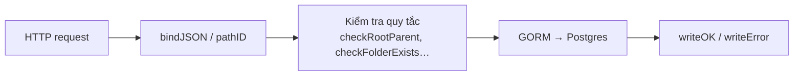

# Backend map — `go-nodus`

Gin + GORM + Postgres, theo [[ADR-001-tech-stack]]. Cả HTTP API là **một package `internal/api`**, mỗi domain một file; quy tắc nghiệp vụ từng tính năng xem `docs/frd/`.

## Cấu trúc

```text
go-nodus/
├── cmd/
│   ├── api/main.go        # đọc config, mở GORM, tạo router, chạy server
│   └── mcp/               # MCP server (stdio) — gọi HTTP API, không đụng DB
├── internal/
│   ├── api/
│   │   ├── server.go      # router, CORS, response/lỗi, bind request, escape LIKE
│   │   ├── notes.go       # /notes — CRUD, move, quy tắc cây 2 cấp
│   │   ├── folders.go     # /folders — CRUD, noteCount
│   │   └── links.go       # /notes/:id/links, /notes/autocomplete, dựng lại wiki-link
│   ├── config/config.go   # biến môi trường
│   └── db/models.go       # model GORM — nguồn schema duy nhất
├── migrations/            # SQL do Atlas sinh + atlas.sum
├── atlas.hcl              # cấu hình Atlas (môi trường `local`)
└── docker-compose.yml     # postgres; atlas-migrate-runner, atlas-dev-db (chỉ chạy khi migrate)
```

## Luồng một request



- Response: `{ "success": true, "data": … }`; lỗi: `{ "success": false, "error": { "code", "message" } }`.
- Lỗi quy tắc là `apiError` (status + `code` ổn định, vd. `note_not_found`, `parent_not_root`); lỗi khác ghi log và trả 500 chung, không lộ chi tiết DB.
- id sai định dạng → 404 (như khi route còn ràng buộc `guid`).

## Route

| Method | Path | File | Ghi chú |
| --- | --- | --- | --- |
| GET | `/health` | `server.go` | |
| GET | `/notes?q=` | `notes.go` | Mới cập nhật trước; `q` lọc title/content (đã escape `%`, `_`) |
| POST | `/notes` | `notes.go` | Có `parentNoteId` → note con, `folder_id` lưu NULL |
| GET, PUT, DELETE | `/notes/:id` | `notes.go` | PUT cập nhật content + dựng lại wiki-link **trong 1 transaction**; DELETE soft delete cả note con |
| PATCH | `/notes/:id/move` | `notes.go` | Bắt buộc gửi đủ `folderId`, `parentNoteId` (cho phép null) — [[FRD-move-note]] |
| GET | `/notes/:id/links` | `links.go` | Backlinks (không tính self-link) + outgoing, mới nhất trước |
| GET | `/notes/autocomplete?q=` | `links.go` | Tối đa 10 title khớp tiền tố |
| GET, POST | `/folders` | `folders.go` | Sắp theo tên; kèm `noteCount` (note gốc trong folder) |
| GET, PATCH, DELETE | `/folders/:id` | `folders.go` | GET kèm danh sách note gốc; DELETE xóa cứng, FK cascade xóa note bên trong |

## Dữ liệu

- `Note.HasChildren`, `Folder.NoteCount` là trường **tính trong query** (`->;-:migration`), không phải cột.
- GORM tự lọc soft delete (`deleted_at`) với query qua model; `Raw` (trong `links.go`) tự thêm `deleted_at IS NULL`.
- Đổi schema: sửa `internal/db/models.go` → `make migrate-diff NAME=…` → review SQL → `make migrate-up`. Rollback local: `make migrate-down-plan` rồi `make migrate-down`; migration đã chia sẻ thì roll forward.
