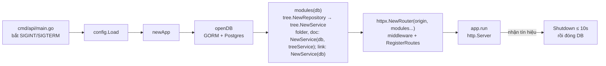
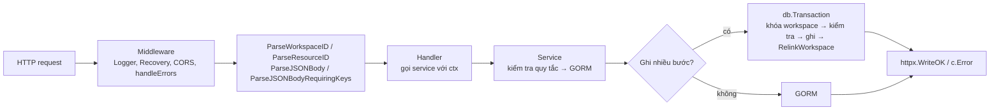

# Backend map — `go-nodus`

Gin + GORM + Postgres, theo [[ADR-001-tech-stack]]. Mỗi domain là **một package** (`internal/modules/folder`, `internal/modules/doc`, `internal/modules/link`, `internal/modules/tree`) gồm handler + service; `internal/httpx` chỉ giữ phần HTTP dùng chung; **`cmd/api`** dựng mọi dependency bằng constructor (DI viết tay, không framework) và chạy server. Quy tắc nghiệp vụ từng tính năng xem `docs/frd/`.

## Cấu trúc

```text
go-nodus/
├── cmd/
│   ├── api/
│   │   ├── main.go        # đọc config, newApp, chạy tới khi nhận SIGINT/SIGTERM
│   │   ├── app.go         # composition root: mở GORM, dựng router + http.Server, graceful shutdown
│   │   └── modules.go     # dựng service rồi handler của từng module (DI bằng constructor)
│   └── mcp/               # MCP server (stdio) — gọi HTTP API, không đụng DB
├── internal/
│   ├── httpx/             # HTTP dùng chung, không chứa domain
│   │   ├── server.go      # NewRouter(origin, modules...), interface Module, response envelope, httpx.Error, FindByID
│   │   └── middleware.go  # ParseWorkspaceID / ParseResourceID, ParseJSONBody, GetWorkspaceID / GetResourceID / GetBody
│   ├── modules/           # các module nghiệp vụ, mỗi module một package (handler + service + types)
│   │   ├── tree/          # cây workspace + quy tắc dùng chung cho folder và doc
│   │   │   ├── handler.go     # chỉ có route GET /workspaces/:id/tree
│   │   │   ├── service.go     # GetTree, LoadIndex, LockWorkspace, PlaceNew, CheckNameFree, MoveItem
│   │   │   ├── repository.go  # truy vấn GORM của tree (nhận tx của caller)
│   │   │   ├── logic.go       # phần thuần, không đụng DB: Index (cây nạp sẵn) và quy tắc độ sâu, tên duy nhất, vị trí
│   │   │   └── types.go       # Node, Item, MoveRequest, Moved
│   │   ├── folder/        # /folders (đổi tên, move, xóa gọi link.RelinkWorkspace)
│   │   ├── doc/           # /docs (tạo, sửa, move, xóa gọi link.RelinkWorkspace)
│   │   └── link/          # wiki-link: backlink, autocomplete, headings, RelinkWorkspace
│   ├── apidocs/           # Swagger do `make swagger` sinh từ annotation (không sửa tay)
│   ├── config/config.go   # biến môi trường
│   └── db/
│       ├── models.go          # model GORM — nguồn schema chính
│       └── extra_schema.sql   # index/CHECK viết tay mà tag GORM không diễn đạt được (`make schema` nối vào schema cho Atlas)
├── migrations/            # SQL do Atlas sinh + atlas.sum
├── atlas.hcl              # cấu hình Atlas (môi trường `local`)
└── docker-compose.yml     # postgres; atlas-migrate-runner, atlas-dev-db (chỉ chạy khi migrate)
```

## Khởi động



- `main.go` chỉ đọc config và chạy; wiring nằm ở `cmd/api/modules.go`.
- Mỗi domain có `Handler` implement `httpx.Module` (có `RegisterRoutes`), nhận `Service` qua constructor; `Service` nhận `*gorm.DB`. Không có biến toàn cục giữ DB. Chỉ `tree` có `Repository` (truy vấn tách khỏi quy tắc); `folder`, `doc`, `link` gọi GORM trực tiếp trong service.
- `folder` và `doc` nhận `*tree.Service` qua constructor (quy tắc cây dùng chung, truyền `tx` của mình vào); `folder` và `doc` import thêm `link` (`link.RelinkWorkspace` khi ghi cây hoặc nội dung). `tree` không import ngược lại; `link` chỉ import `tree` để dùng `GetDocParent`/`GetParentID`.
- Tắt êm: ngừng nhận kết nối mới, chờ request đang chạy xong (tối đa 10 giây), rồi đóng pool DB.

## Thêm domain mới

1. Tạo package `internal/modules/<domain>/`: `handler.go` (`Handler`, `NewHandler(service)`, `RegisterRoutes`, handler mỏng), `service.go` (`Service`, `NewService(db)`, quy tắc + GORM), `types.go`.
2. Thêm `<domain>.NewHandler(<domain>.NewService(database))` vào `cmd/api/modules.go`.
3. Có bảng mới → sửa `internal/db/models.go` và sinh migration (mục **Dữ liệu**).
4. Viết annotation swaggo trên từng handler rồi chạy `make swagger` (xem **API docs** dưới đây).
5. Cập nhật bảng **Route** dưới đây và FRD liên quan.

## Luồng một request



- Handler chỉ bind, gọi một method của service, trả response. Lỗi thì `_ = c.Error(err)` rồi return; middleware `handleErrors` trả response lỗi.
- Quy tắc cây (`tree.PlaceNew`, `tree.MoveItem`, `tree.CheckNameFree`…) và `link.RelinkWorkspace` nhận `*gorm.DB` làm tham số nên chạy trong transaction của `folder`/`doc`.
- Mọi ghi vào cây (tạo, đổi tên, move, xóa) chạy trong transaction và khóa dòng workspace (`FOR UPDATE`), nên các kiểm tra độ sâu và trùng tên không bị race. Cây nạp cả workspace mỗi lần ghi (xem chú thích `ponytail:` trong `tree/logic.go`).
- Response: `{ "success": true, "data": … }` (DELETE trả `204` không body); lỗi: `{ "success": false, "error": { "code", "message" } }`.
- Lỗi quy tắc là `httpx.Error` (status + `code` ổn định, vd. `folder_not_found`, `max_depth_exceeded`, `name_conflict`); lỗi khác ghi log và trả 500 chung, không lộ chi tiết DB.
- id sai định dạng → 404 (`folder_not_found`, `doc_not_found` hoặc `workspace_not_found` tùy route).

## Route

| Method | Path | Module | Ghi chú |
| --- | --- | --- | --- |
| GET | `/health` | `httpx` | |
| GET | `/swagger/index.html` | `cmd/api` | Giao diện Swagger; URL cũng được log khi API khởi động |
| GET | `/workspaces/:workspaceId/tree` | `tree` | Danh sách phẳng folder + doc, xếp theo `position` |
| POST | `/workspaces/:workspaceId/folders` | `folder` | Quy tắc: tên 1–200 ký tự không chứa `/ # \| [ ]`, độ sâu tối đa 4, không trùng tên cùng cha — [[FRD-folder]] |
| GET, PATCH, DELETE | `/folders/:id` | `folder` | GET kèm `children`; PATCH đổi `name`/`description`; DELETE xóa cứng, FK cascade |
| PATCH | `/folders/:id/move` | `folder` | Bắt buộc gửi đủ `parentId`, `afterId` (cho phép null) — [[FRD-move]] |
| POST | `/workspaces/:workspaceId/docs` | `doc` | Tạo doc + dựng wiki-link **trong 1 transaction** — [[FRD-doc]] |
| GET, PUT, DELETE | `/docs/:id` | `doc` | GET kèm `prev`/`next` theo thứ tự đọc; PUT sửa title + content và dựng lại wiki-link; DELETE soft delete cả doc con |
| PATCH | `/docs/:id/move` | `doc` | Như move folder — [[FRD-move]] |
| GET | `/docs/:id/links` | `link` | `backlinks` (`id`, `title`, `path`; mỗi doc nguồn một dòng, không tính self-link) + `outgoing` (`ref`, `doc` hoặc `null` nếu broken), sắp theo chữ — [[FRD-wiki-link]] |
| GET | `/workspaces/:workspaceId/docs/autocomplete?q=` | `link` | Tối đa 10 doc có title chứa `q`, kèm `path` và `ref` ngắn nhất để chèn |
| GET | `/docs/:id/headings` | `link` | Heading ATX (`level`, `text`), bỏ heading trong code fence |

## API docs

- Mỗi handler có annotation swaggo (`@Summary`, `@Tags`, `@Param`, `@Success`, `@Failure`, `@Router`). `make swagger` sinh `internal/apidocs/` (file sinh ra, được commit, không sửa tay).
- Mở `/swagger/index.html` trên cổng của API (mặc định http://localhost:8080/swagger/index.html) để xem và gọi thử route. `uuid.UUID` được khai báo là `string` trong `.swaggo`.
- Sửa route, request hoặc response type thì chạy lại `make swagger`.

## Dữ liệu

- Bảng: `workspaces`, `folders`, `docs`, `doc_links`. Doc nằm ở gốc, trong folder (`folder_id`) hoặc trong doc khác (`parent_doc_id`), không bao giờ cả hai (CHECK `docs_one_parent`).
- `doc_links`: `source_doc_id`, `target_ref` (chữ trong `[[...]]`, bỏ `#heading`; `[[...]]` trong code span/code fence không tính), `target_doc_id` (NULL = broken link, FK `SET NULL`). Unique `(source_doc_id, lower(target_ref))` viết tay trong migration. Mỗi lần ghi cây hoặc nội dung, `link.RelinkWorkspace` xóa và dựng lại link của cả workspace trong cùng transaction (xem `ponytail:` trong `link/relink.go`).
- Tên folder và title doc không trùng (không phân biệt hoa thường) trong cùng một cha: unique index viết tay trong migration, khai báo thêm ở `internal/db/extra_schema.sql` để Atlas không đề nghị xóa.
- GORM tự lọc soft delete (`deleted_at`) với mọi query qua model, kể cả `Preload`; không còn câu SQL thô nào phải tự thêm `deleted_at IS NULL`.
- Đổi schema: sửa `internal/db/models.go` → `make migrate-diff NAME=…` → review SQL → `make migrate-up`. Rollback local: `make migrate-down-plan` rồi `make migrate-down`; migration đã chia sẻ thì roll forward.
