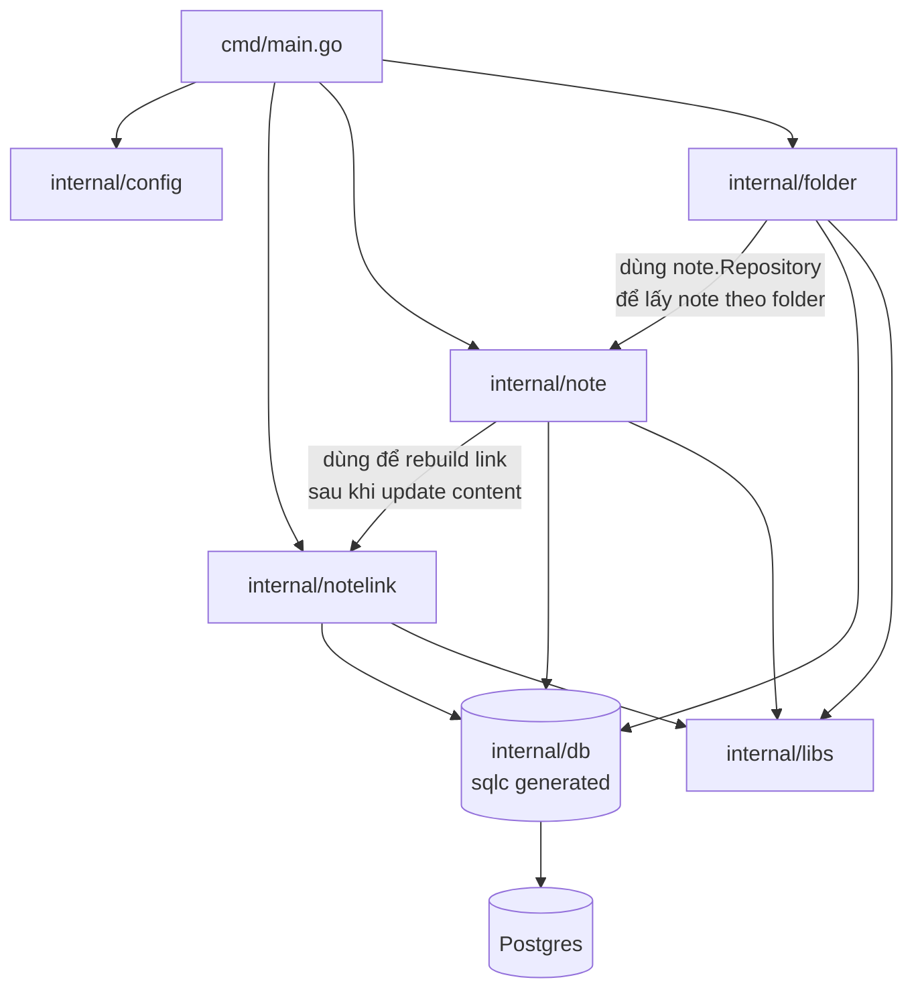
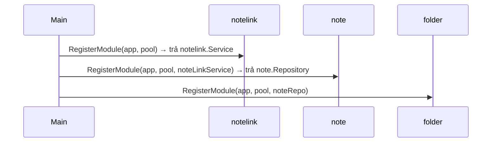

# Backend site map — `go-nodus`

> Mô tả code hiện tại (Fiber). Sẽ viết lại khi chuyển sang Gin ở giai đoạn 0 của [[ADR-001-tech-stack]].

Tổng quan toàn bộ module trong backend: mỗi module có gì, phụ thuộc gì, nhận/trả gì. Quy tắc nghiệp vụ từng tính năng xem `docs/frd/`.

## Kiến trúc chung

Fiber v3 (HTTP), sqlc + pgx (data access), Postgres. Mỗi domain là 1 package trong `internal/`, theo layer cố định:

```
routes.go      → đăng ký route, gắn middleware
middleware.go  → validate format request, set vào fiber.Locals
handler.go     → đọc request đã validate, gọi service, trả response
service.go     → business rule (tồn tại? hợp lệ? rule kế thừa?)
repository.go  → convert domain type ↔ sqlc type, gọi db.Queries
entity.go      → struct domain (dùng uuid.UUID, time.Time — không lộ pgtype ra ngoài repository)
interface.go   → interface Service (nếu handler cần mock/test độc lập)
module.go      → wire dependency (New... theo thứ tự repo→service→handler), export cho main.go
```

`internal/db/` là code sinh tự động bởi sqlc (`DO NOT EDIT`) từ `internal/db/queries/*.sql` — dùng chung cho mọi module, kiểu dữ liệu là `pgtype.*` (không phải kiểu Go thuần).

## Sơ đồ phụ thuộc module



Lưu ý: `notelink` **không** import `note` hay `folder` — tránh vòng phụ thuộc, vì `note` đã phụ thuộc `notelink`. Route `/notes/:id<guid>/links` trong `notelink` tự parse lại `id` từ `c.Params`, không tái dùng middleware của `note`.

## Module: `internal/config`

Đọc biến môi trường, tạo connection pool.

| | |
|---|---|
| Input | `.env` / biến môi trường: `DATABASE_URL`, `ALLOWED_ORIGIN`, `PORT` (mặc định `8080`) |
| Output | `config.Config` (struct thuần), `*pgxpool.Pool` (qua `Connect`) |
| Phụ thuộc | Không phụ thuộc module domain nào |

## Module: `internal/libs`

Helper dùng chung, không chứa business logic.

| File | Việc |
|---|---|
| `response.go` | `Success(c, status, data)` → format response thành công thống nhất `{ success: true, data }` |
| `error.go` | `DefaultErrorHandler` — bắt mọi `error` trả về từ handler, format thành `{ success: false, error: { message } }`, giữ đúng HTTP status nếu là `*fiber.Error`; `IsNotFound(err)` — phân biệt "không tìm thấy" (`pgx.ErrNoRows`) với lỗi DB khác |

## Module: `internal/db`

Code sinh bởi sqlc từ `internal/db/queries/*.sql` (`folder.sql`, `note.sql`, `note_link.sql`). Không sửa tay.

| | |
|---|---|
| Nhận | SQL query đã viết tay trong `queries/*.sql` |
| Sinh ra | `db.Queries` (1 method Go cho mỗi `-- name:`), `db.Models` (struct ánh xạ trực tiếp từng bảng, dùng `pgtype.*`) |
| Dùng bởi | `note.Repository`, `folder.Repository`, `notelink.Repository` — mỗi module tự gọi `db.New(pool)` để lấy instance `*db.Queries` riêng |

## Module: `internal/note`

CRUD note + di chuyển note trong cây folder/note 2 cấp (root note + note con).

| | |
|---|---|
| Route | `GET /notes`, `POST /notes`, `GET /notes/:id`, `PUT /notes/:id`, `DELETE /notes/:id`, `PATCH /notes/:id/move` |
| Nhận | `createNoteRequest` (title, content, folderId?, parentNoteId?), `updateNoteContentRequest` (title, content), `moveNoteRequest` (folderId, parentNoteId — bắt buộc gửi cả 2 key) |
| Trả | `Note` (id, title, content, folderId?, parentNoteId?, hasChildren, createdAt, updatedAt) |
| Business rule | Note con lưu `folder_id = NULL`, folder hiệu lực lấy từ cha; note có con không được re-parent; cha mới phải là note gốc thật (giữ tối đa 2 cấp); xóa note cha soft delete luôn note con. Chi tiết: [[FRD-note-hierarchy]], [[FRD-move-note]] |
| Phụ thuộc | `notelink.Service` (gọi `RebuildLinksFromContent` sau khi `Update` thành công — [[FRD-wiki-link]]); đọc thẳng `db.Queries.FindFolderByID` để check folder tồn tại (không qua `folder.Repository`, tránh import cycle vì `folder` đã phụ thuộc `note`) |
| Export cho module khác | `note.Repository` (folder dùng để lấy note theo `folderId`), `note.ValidateID` (middleware validate `:id<guid>`) |

## Module: `internal/folder`

CRUD folder, xem chi tiết folder kèm danh sách note bên trong.

| | |
|---|---|
| Route | `GET /folders`, `POST /folders`, `GET /folders/:id`, `PATCH /folders/:id`, `DELETE /folders/:id` |
| Nhận | `createFolderRequest` (name), `updateFolderRequest` (name) |
| Trả | `Folder` (id, name, noteCount, createdAt, updatedAt); `GET /folders/:id` trả `FolderDetail` (Folder + danh sách `Notes`) |
| Phụ thuộc | `note.Repository` (gọi `FindByFolderID` để dựng `FolderDetail`) |
| Export cho module khác | Không có module nào phụ thuộc `folder` |

## Module: `internal/notelink`

Parse wiki-link `[[Title]]`, đồng bộ bảng `note_links`, cung cấp backlink + autocomplete title. Được `note` gọi vào, còn tự expose route riêng.

| | |
|---|---|
| Route | `GET /notes/:id/links`, `GET /notes/autocomplete?q=` |
| Nhận (qua service, không qua HTTP) | `RebuildLinksFromContent(ctx, sourceNoteID, content)` — gọi từ `note.service.Update` |
| Trả (HTTP) | `/links` → `NoteLinks { backlinks: []LinkedNote, outgoing: []LinkedNote }`; `/autocomplete` → `[]NoteTitleSuggestion` (tối đa 10, sort alphabet) |
| Business rule | `note_links` derive toàn bộ từ `content` mỗi lần save (xóa cũ, insert lại — không diff); title được trim, title không tồn tại thì bỏ qua, không tự tạo note; self-link không tính là backlink. Chi tiết: [[FRD-wiki-link]] |
| Phụ thuộc | Không phụ thuộc `note`/`folder` (tránh import cycle) |
| Export cho module khác | `notelink.Service` (dùng trong `main.go` để truyền vào `note.RegisterModule`) |

## Thứ tự khởi tạo (`cmd/main.go`)



Thứ tự bắt buộc: `notelink` phải khởi tạo trước `note` (note cần `notelink.Service`), `note` phải khởi tạo trước `folder` (folder cần `note.Repository`).
