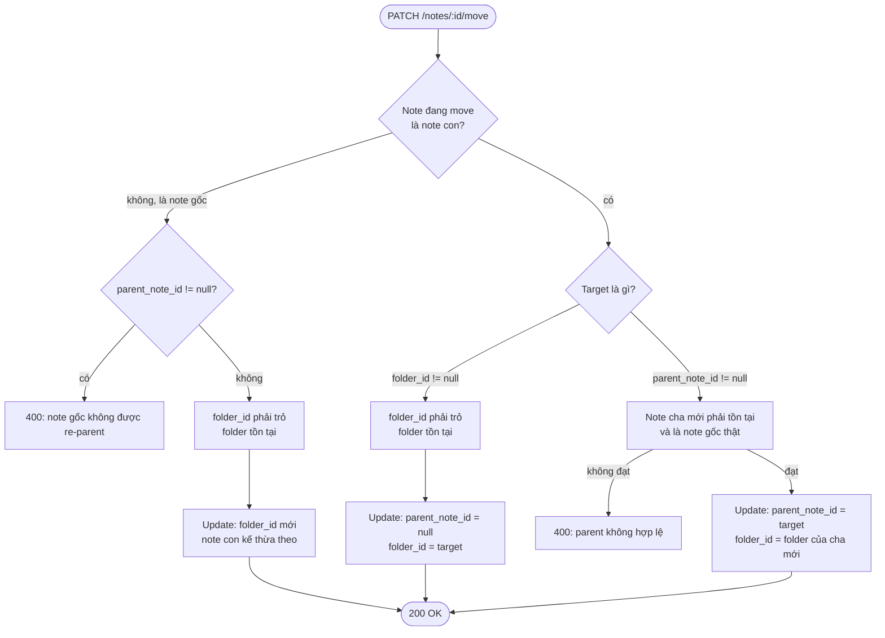

# FRD — Move note

Nguồn: SPEC.md v2.

## Mục tiêu

Thay đổi **vị trí của 1 note trong cây tổ chức** (folder và/hoặc quan hệ cha–con) — không chỉ "đổi folder".

## API — `PATCH /notes/:id/move`

Tách khỏi `PUT /notes/:id` (chỉ sửa nội dung). Body luôn gửi đủ `{ "folder_id": string | null, "parent_note_id": string | null }`, **đúng 1 trong 2 khác `null`**.

## Sơ đồ validate

- "Promote to root, giữ nguyên folder" = trường hợp riêng của nhánh **UpdateB**, client tự tính `folder_id` = folder hiện tại của cha. Không cần rule riêng.
- Cả 2 field cùng khác `null` (trái hợp đồng UI): xử lý dự phòng — **chưa chốt**.

## UI — modal "Move to..."

- Nút 3 chấm trên mỗi note item (`UTree`) → "Move to...".
- Note gốc: modal chỉ có tree-picker folder. Note con: modal cho chọn folder **hoặc** note gốc khác làm cha mới, kèm cảnh báo tách khỏi cha hiện tại.
- Xác nhận → 1 request duy nhất, đúng 1 field có giá trị theo lựa chọn.
