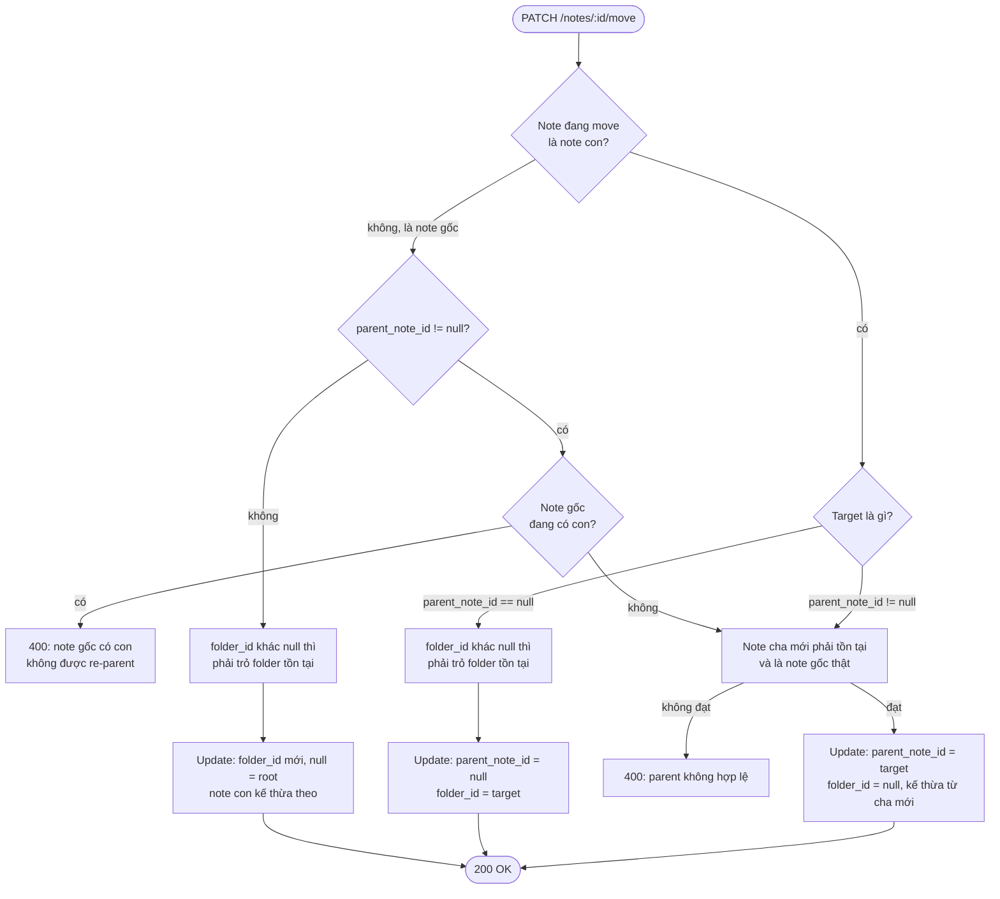

# FRD — Move note

Nguồn: [[SPEC-v2]].

## Mục tiêu

Thay đổi **vị trí của 1 note trong cây tổ chức** (folder và/hoặc quan hệ cha–con) — không chỉ "đổi folder".

## API — `PATCH /notes/:id/move`

Tách khỏi `PUT /notes/:id` (chỉ sửa nội dung). Body luôn gửi đủ cả 2 key `{ "folderId": string | null, "parentNoteId": string | null }`:

| `folderId` | `parentNoteId` | Đích |
| --- | --- | --- |
| khác `null` | `null` | Note gốc trong folder đó |
| `null` | khác `null` | Note con của note gốc đó |
| `null` | `null` | Note gốc ở root (không folder) |

## Sơ đồ validate

- "Promote to root, giữ nguyên folder" = trường hợp riêng của nhánh **UpdateB**, client tự tính `folder_id` = folder hiện tại của cha. Không cần rule riêng.
- Note gốc re-parent (nhánh **HasChildren = không**) đi chung bước kiểm tra note cha mới với note con: cha mới phải tồn tại và là note gốc thật.
- Cả 2 field cùng khác `null` (trái hợp đồng UI): server **ưu tiên `parentNoteId`, bỏ qua `folderId`** — nhất quán với `POST /notes`.
- Note không được làm cha của chính nó (`400`). Note không tồn tại → `404`.
- Kiểm tra và cập nhật là một thao tác nguyên tử: move hoặc tạo note con chạy đồng thời không thể vượt qua các bước validate trên (ví dụ: một note vừa được gán con thì không còn được move vào dưới note khác).

## UI — modal "Move to..."

- Menu của mỗi note trên cây sidebar → "Move to...". Danh sách đích gồm nhóm **Folder** (kèm "Root — no folder") và nhóm **Note cha**; modal chọn sẵn vị trí hiện tại.
- Note gốc chưa có con: modal cho chọn folder **hoặc** note gốc khác làm cha mới. Note gốc đang có con: chỉ chọn folder (đọc field `hasChildren` để disable lựa chọn note cha).
- Note con: modal cho chọn folder **hoặc** note gốc khác làm cha mới, kèm cảnh báo tách khỏi cha hiện tại.
- Xác nhận → 1 request duy nhất: `folderId` hoặc `parentNoteId` theo lựa chọn; chọn Root thì cả 2 là `null`. Chọn đúng vị trí hiện tại → không gửi request.

## Chưa chốt

- Swagger 2.0 (swaggo) không mô tả được "bắt buộc có key nhưng cho phép null" — giữ hợp đồng này hay đổi sang `targetType`/`targetId` ([[ADR-001-tech-stack]] mục 8). Đổi là thay đổi API contract, cần duyệt.
