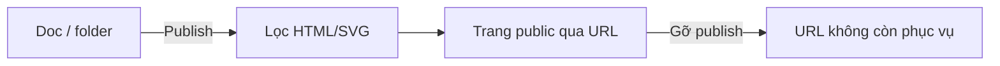

# FRD — Publish

Nguồn: [[BRD]], [[SPEC-v5]]. Phụ thuộc [[FRD-account]], [[FRD-sitemap]], [[FRD-editor-preview]]. Chưa kiểm tra gói trả phí ở giai đoạn này; khi có [[FRD-billing]] chỉ thêm một chỗ kiểm tra gói.

## Mục tiêu

Biến 1 doc hoặc 1 folder thành **trang public** đọc được qua URL, không cần tài khoản. Về lâu dài đây là tính năng trả phí vì Nodus phải host và phục vụ trang cho người lạ; giai đoạn đầu miễn phí. Khác share ([[FRD-share]]): share là cho người cụ thể, có đăng nhập.

## Yêu cầu

### Phạm vi

- Publish **1 doc** (kèm mọi doc con) hoặc **1 folder** (kèm cả nhánh bên dưới).
- Chỉ nội dung trong phạm vi publish được hiển thị. Link `[[...]]` trỏ ra ngoài phạm vi → hiện như chữ thường, không lộ nội dung hay title doc ngoài phạm vi.
- Member của workspace publish và gỡ được. Giai đoạn này mọi workspace đều publish được; sau này gắn gói trả phí ([[FRD-billing]]): hết gói → trang publish ngừng phục vụ, không xóa nội dung gốc.

### URL và domain

- URL dạng `https://<pages-domain>/<slug>`. Trang public phục vụ trên **tên miền riêng, tách khỏi app** (ví dụ app ở `nodus.xxx`, trang public ở `nodus-pages.xxx`) và không dùng chung cookie với app. Nội dung người dùng có HTML/SVG, nên một lỗ lọc không được đánh cắp phiên đăng nhập; tách tên miền sau thì mọi URL đã chia sẻ gãy, nên làm từ đầu.
- **Slug** do người dùng đặt khi publish (`a-z`, `0-9`, `-`, 3–60 ký tự) hoặc server tự sinh từ tên + 6 ký tự ngẫu nhiên; duy nhất toàn hệ thống (`409 slug_taken`); đặt lúc publish và **không đổi theo title** — đổi tên doc không làm chết URL đã gửi.
- Trang **tự cập nhật** theo nội dung hiện tại của phạm vi, không có bước "publish lại". Doc mới thêm vào phạm vi cũng được hiển thị.

### Trang publish

- Đọc được **không cần đăng nhập**, chỉ đọc. Có:
  - **Sitemap** của phạm vi publish, đúng thứ tự [[FRD-sitemap]].
  - **Mục lục** trong trang ([[FRD-editor-preview]]).
  - **Trang trước / trang sau** theo sitemap, trong phạm vi.
  - Backlinks giới hạn trong phạm vi publish.
- Không có editor, không có nút sửa. Dùng được trên mobile.
- Render ở `next-nodus` (SPA), dùng chung bộ render với preview, không có bộ render thứ hai.

### Bảo mật và chống lạm dụng

- Nội dung **bắt buộc** đi qua bộ lọc HTML/SVG của [[FRD-editor-preview]] trước khi hiển thị. Không có ngoại lệ, kể cả nội dung do chính chủ viết.
- Code chỉ hiển thị, không chạy; CSS người dùng không áp lên trang ([[BRD]] mục 7).
- Giới hạn tốc độ truy cập theo IP (`429`); giới hạn số publication mỗi workspace (mặc định 20, cấu hình bằng biến môi trường); quản trị viên Nodus gỡ được trang vi phạm bằng cách đặt `disabled_at` (chưa có màn hình quản trị).

### Quản lý

- Thành viên workspace xem được danh sách đang publish và URL tương ứng.
- **Gỡ publish** bất cứ lúc nào → URL trả về `404` ngay, không còn phục vụ nội dung cũ.

## Chưa chốt

- Custom domain (`docs.tenduan.com`), subdomain theo workspace.
- Bảo vệ trang publish bằng mật khẩu.
- Quản trị viên Nodus: màn hình quản trị thay cho đặt `disabled_at` bằng SQL.
