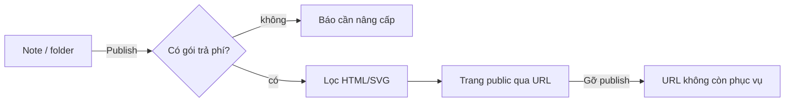

# FRD — Publish

Nguồn: [[BRD]], [[SPEC-v5]]. Phụ thuộc [[FRD-storage]], [[FRD-sitemap]], [[FRD-editor-preview]], [[FRD-billing]].

## Mục tiêu

Biến 1 trang hoặc 1 folder thành **trang public** đọc được qua URL, không cần tài khoản. Đây là tính năng trả phí vì Nodus phải host và phục vụ trang cho người lạ. Khác share ([[FRD-share]]): share là cho người cụ thể, có đăng nhập.

## Yêu cầu

### Phạm vi

- Publish **1 note** (kèm note con nếu là note gốc) hoặc **1 folder**.
- Chỉ nội dung trong phạm vi publish được hiển thị. Link `[[...]]` trỏ ra ngoài phạm vi → hiện như chữ thường, không lộ nội dung hay title note ngoài phạm vi.
- Chỉ tài khoản có gói trả phí ([[FRD-billing]]) mới publish được. Hết gói → trang publish ngừng phục vụ (không xóa nội dung gốc).

### Trang publish

- Đọc được **không cần đăng nhập**, chỉ đọc.
- Có:
  - **Sitemap** của phạm vi publish, đúng thứ tự [[FRD-sitemap]].
  - **Mục lục** trong trang ([[FRD-page-toc]]).
  - **Trang trước / trang sau** theo sitemap.
  - Backlinks giới hạn trong phạm vi publish.
- Không có editor, không có nút sửa.

### Bảo mật

- Nội dung **bắt buộc** đi qua bộ lọc HTML/SVG của [[FRD-editor-preview]] trước khi hiển thị. Không có ngoại lệ, kể cả nội dung do chính chủ tài khoản viết.
- Code chỉ hiển thị, không chạy; CSS người dùng không áp lên trang ([[BRD]] mục 7).

### Quản lý

- Chủ tài liệu xem được danh sách đang publish và URL tương ứng.
- **Gỡ publish** bất cứ lúc nào → URL trả về "không tồn tại" ngay, không còn phục vụ nội dung cũ.

## Cần duyệt

- API: endpoint publish/gỡ publish, endpoint đọc trang public không cần auth.
- Hạ tầng: phục vụ trang public (cache, giới hạn truy cập để chống lạm dụng).
- Schema: bảng publish (phạm vi, URL, trạng thái).

## Chưa chốt

- Định dạng URL (ví dụ `nodus.xxx/p/<slug>` hay subdomain theo tài khoản).
- Trang publish **tự cập nhật** khi tài liệu gốc thay đổi, hay chỉ cập nhật khi bấm **publish lại**.
- Custom domain (`docs.tenduan.com`).
- Bảo vệ trang publish bằng mật khẩu.
- Ở chế độ Drive: trang publish đọc trực tiếp từ Drive hay Nodus giữ một bản sao để phục vụ.
